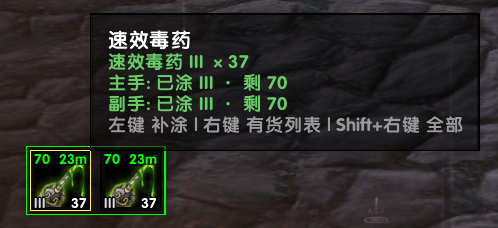

# MartletPoison

Turtle WoW（1.18.1）盗贼涂毒/武器槽助手。**v0.4.0 武器槽版**（weapon-slots 分支）。

场景：双持两套武器，各涂一种毒（如速效/溶解），MC 石头人↔大狗切换时一键换装 =
**瞬切毒药**——毒涂在武器上，第二套提前涂好，一次涂毒用整场。

## 核心原则

面板显示**武器状态**；涂了什么毒**跟武器走**；没有任何全自动上毒
（"记住上次毒 + 用户左键一下才涂"就是全部语义）。

## 看板（收起态）

两个图标 = 当前主手/副手**武器**：

- 主体 = 武器图标；**左下角标 = 所涂毒药的小图标，没涂毒显示红叉**
- 左上 = 剩余次数（时间型 ∞），右上 = 剩余时间，右下 = 同款武器背包库存
- 看板边框颜色跟随两手余量较差一侧（绿→黄→橙→红，<10% 大红；完全无记忆=白）
- 等级(III/VI)信息在悬停 tooltip 里
- 截图为 v0.3.1（毒药图标版看板），v0.4.0 界面以文字描述为准



## 武器图标手势（当前武器和候选槽武器通用）

| 手势 | 行为 |
|---|---|
| 左键 | 补涂这把武器上次的毒（防浪费护栏：余量绿/黄时拦下，橙/红才真的涂） |
| 右键 | 弹出竖排毒药列表，点某项 = 给**这把**武器上这个毒 |
| （列表打开时） | 插件区域外任意左/中/右键点击 = 关闭列表；ESC 同效 |

- 列表内容默认"包里有货"，`/mpoison listmode all|stock` 切换默认，Shift+右键临时反转
- 列表向上弹出，全屏拦截层兜底，不会挡视线

## 候选武器槽（切换按钮展开）

看板右端的切换按钮展开/收起候选区；**第一次展开自动给一套空槽**：

```
┌─ 候选1 ─────────┐  ┌─ 候选2 ─┐  ⊕
│ [武器][武器]     │  │ [空][空] │
│  [换装]     [×] │  │ (同款)   │
└─────────────────┘  └─────────┘
```

- **摆武器 = 从背包带着武器点空槽**（带物品点击即摆放）；再点已占槽 = 替换
- 候选武器同样显示毒角标/红叉、剩余次数、背包库存（剩余时间读不到，显示 -）
- **大按钮"换装"** = 切到这组武器（两手齐才可用）；换下来的武器带着毒回包，两套循环互不污染
- 当前装备中的那组：绿边框 + 按钮置灰"当前"
- **小按钮 ×** = 删除整组（防误触）
- ⊕ = 加一套空槽（上限 4 组，删空自动补一套）
- 换装是双槽队列（MH/OH 分笔执行，0.25s 间隔，撞槽位锁自动等待/超时中止）

## 悬停 Tooltip

种类名 ｜ 背包内各等级数量 ｜ 两手当前状态（含等级） ｜ 灰字操作提示

## 技术要点

- 涂毒连招移植自 EzPoison（使用毒药 → 点武器槽 → ReplaceEnchant），原子操作
- 换装连招 = PickupContainerItem + PickupInventoryItem（1.12 战斗中允许换武器；
  参考 Outfitter QuickSwap 的锁定/兜底处理）
- **背包中的武器无法程序化涂毒**（引擎把对包中武器的使用当成装备，实测确认）——
  手动涂法：右键毒药 → 点包里的武器；插件会自动识别并显示毒角标/次数
- 换装定位顺序: 上次背包位置(ID 对得上优先) → 扫 ID+期望毒匹配 → 任意同 ID
  （同 ID 多把武器靠"期望毒"区分；毒耗尽后靠"最近位置"兜底）
- **双语**：背包匹配按物品 ID（语言无关）；武器附魔按中英文名+特征匹配；界面文案自动切换
- pfUI 皮肤适配；只认随身 4 包（银行武器视为没有）

## 明确不做

- 全自动补涂（只有"记住上次毒 + 左键确认"）
- 方案（配置文件）概念、等级选择（永远最高级）
- 半套组（候选组必须两手齐才能换装）

## 命令

`/mpoison` 开关面板 | `scale N` | `lock`/`unlock` | `pos x,y` | `time N` |
`listmode stock|all` | `reset`

## 版本

- v0.4.0 (weapon-slots)：武器槽版——看板主体改武器图标+毒角标/红叉；毒药列表改为
  武器图标右键弹出+区域外点击关闭；新增候选武器槽（空槽摆放/一键换装/删除/⊕上限 4）
- v0.3.1：大红阈值提前到 <10%；看板/列表拆独立边框
- v0.3.0：双语化；列表向上弹出
- v0.2.1：列表项右键恢复涂副手
- v0.2.0：双看板+四角信息+有货/全量列表
- v0.1.0：图标墙版
